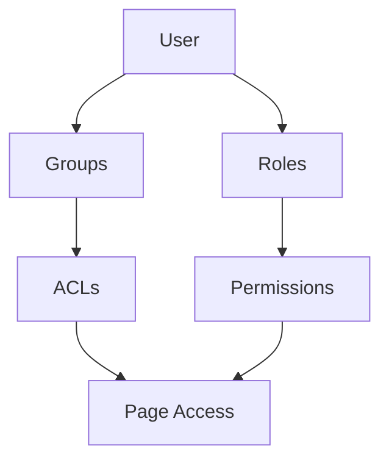
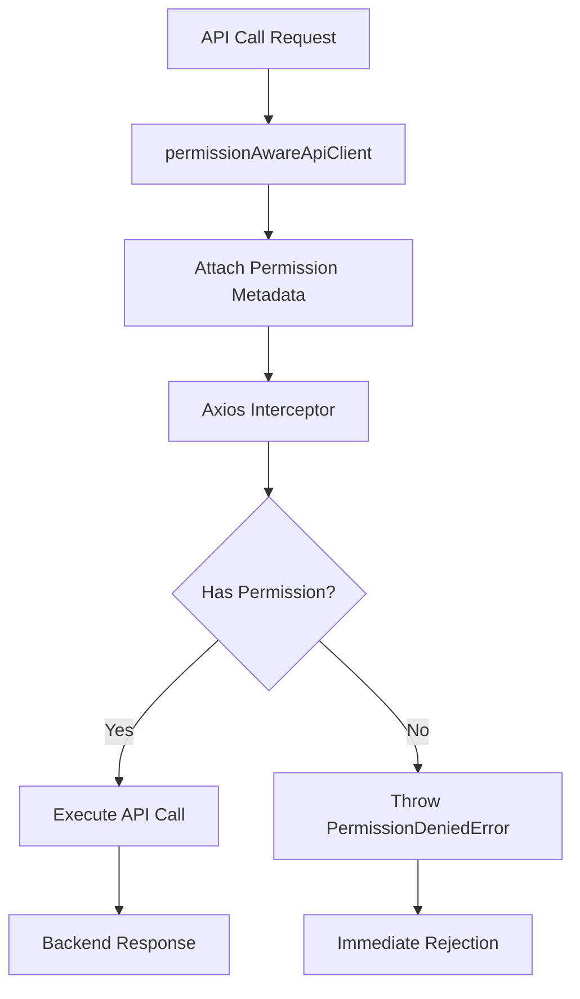

/*
SPDX-FileCopyrightText: 2026 Humdek, University of Bern
SPDX-License-Identifier: MPL-2.0
*/
# 9. User Permissions & ACL System

Audience: Developers and technical operators.
Status: active.
Applies to: SelfHelp2 Next.js frontend.
Last verified: 2026-11-20.
Source of truth: Runtime code, configuration, and tests in this repository.

## Permission Architecture

The system implements role-based access control (RBAC) with granular permissions:



## Permission Structure

**Users** can have:
- Direct **Roles** (with permissions)
- **Group** memberships (with ACLs)

**Groups** have:
- **ACLs** (Access Control Lists) for specific pages
- One page-level right: `select`. A group member who has it can see the page
  and use everything it offers (submit its forms, update and delete their own
  records). There is no group right to insert, update or delete; editing rights
  belong to roles (workspace concept "Page ACL", `concepts/concepts.md`).

**Roles** have:
- System-wide **Permissions**
- Administrative capabilities

## ACL Management System

```typescript
// Page access for groups: one right, select (can see the page and use its forms)
interface IGroupPageAcl {
    page_id: number;
    acl_select: boolean;
}

// Group page-access editor (one "Can see" checkbox per page)
<AclManagement
    selectedPages={selectedPages}
    onChange={setSelectedPages}
/>
```

## Permission Validation

**Frontend Validation**:
```typescript
// Check if user has specific permission
const hasPermission = (permission: string): boolean => {
    const user = getCurrentUser();
    return user?.permissions?.includes(permission) || false;
};

// Restrict UI based on permissions
{hasPermission('admin.users.create') && (
    <Button onClick={handleCreateUser}>Create User</Button>
)}
```

## Server-Side Admin Route Protection

The admin console (`/admin/*`) is gated **on the server, before any client
component mounts**. This is the authoritative authorization layer: an
unauthorized user is redirected away and the admin page — and therefore its
data-loading React Query hooks — never render. There is no "load the page, fire
the request, then handle a 403" flash.

### Why server-side

Previously the admin layout only verified *authentication* (a valid `sh_auth`
cookie + non-empty `/auth/user-data`). A logged-in user **without** the relevant
admin permission still rendered the page, so the page's data hook fired and
showed a spinner before the backend rejected the request. The fix moves the
*authorization* check into Server Components so the decision happens before the
client renders, on both the initial request and on client-side navigation
(App Router re-runs `page.tsx` server components on navigation).

### The guard module

`src/app/_lib/admin-guard.ts` exposes two helpers, both backed by the
`cache()`-wrapped `getAuthMeSSR()` (so they share a single `/auth/user-data`
round-trip per render):

```typescript
// Broad gate — used by src/app/admin/layout.tsx for the whole segment.
// Redirects to /login when unauthenticated, /no-access without `admin.access`.
await requireAdminAccessSSR();

// Per-page gate — admin.access PLUS a specific permission (or any of a list).
// Redirects to /no-access when the permission is missing.
await requireAdminPermission(PERMISSIONS.ADMIN_SCHEDULED_JOB_READ);
await requireAdminPermission([
    PERMISSIONS.ADMIN_PLUGINS_MANAGE,
    PERMISSIONS.ADMIN_PLUGINS_EXECUTE,
    PERMISSIONS.ADMIN_PLUGINS_PURGE,
]);
```

- **Unauthenticated** (no cookie / empty envelope) → redirect to `ROUTES.LOGIN`.
- **No `admin.access`** → redirect to `ROUTES.NO_ACCESS` (`/no-access`).
- **Missing the page's specific permission** → redirect to `ROUTES.NO_ACCESS`.

`/admin/layout.tsx` calls `requireAdminAccessSSR()` once for the segment; each
`page.tsx` (and `admin/pages/layout.tsx` for the client page editor) adds its
specific `requireAdminPermission(...)`. The permission strings mirror the
client `permissionChecker.canReadX()` checks used by `AdminNavbar`, so a hidden
sidebar link and a directly typed URL always resolve to the same decision.

### Route → required permission map

| Route | Required permission(s) |
|-------|------------------------|
| `/admin/*` (segment baseline) | `admin.access` (layout) |
| `/admin/users` | `admin.user.read` |
| `/admin/groups` | `admin.group.read` |
| `/admin/roles` | `admin.role.read` |
| `/admin/registration-codes` | `admin.registration_code.read` |
| `/admin/assets` | `admin.asset.read` |
| `/admin/unused-sections` | `admin.section.read` (deleting stays `admin.section.delete`) |
| `/admin/pages/*` | `admin.page.read` (`pages/layout.tsx`) |
| `/admin/actions` | `admin.action.read` |
| `/admin/scheduled-jobs`, `/admin/scheduled-jobs/calendar` | `admin.scheduled_job.read` |
| `/admin/languages` | `admin.language.read` (changes need `admin.language.update`) |
| `/admin/data` | `admin.data.read` |
| `/admin/data-access` | `admin.audit.read` |
| `/admin/cache` | `admin.cache.read` |
| `/admin/preview/[[...slug]]` | `admin.mobile_preview.read` |
| `/admin/plugins`, `/admin/plugins/[id]` | any of `admin.plugins.manage` / `.execute` / `.purge` |
| `/admin/plugins-host/[pluginId]/[slug]` | `admin.access` plus the permission the plugin declares for that page in its manifest (`adminPages[].permission`), checked on the server by `requirePluginAdminPageAccess` in `src/app/_lib/plugin-admin-page-guard.ts`; the nav entry uses the same permission. An unknown plugin or slug keeps only `admin.access` and the host shows its not-found state |

### Write controls follow the route's right

A screen opens with its area's read right; each button that writes is drawn only
for a person who holds the right of the route it calls (the same right as in
`src/config/api.config.ts`). Without any write right the screen is read-only.

| Screen | Control | Right |
|--------|---------|-------|
| Languages | Add Language, edit, delete | `admin.language.update` (one right for all three) |
| Actions | New Action, edit | `admin.action.update` |
| Actions | delete | `admin.action.delete` |
| Cache | Clear all / category / user / API routes | `admin.cache.clear` |
| Cache | Reset Statistics | `admin.cache.manage` (the card is left out without either right) |
| Scheduled jobs (list, calendar, details) | Execute Job | `admin.scheduled_job.execute` |
| Scheduled jobs | Delete Job, row selection and bulk delete | `admin.scheduled_job.delete` |
| Page editor | Add Section, move, section actions, Save, fields, Restore | `rights.can_update` of the page read (`admin.page.update` + update grant on the page) |
| Page editor | Publish Changes | `rights.can_publish` (`admin.page_version.publish` + update grant) |
| Page editor | Delete Version | `admin.page_version.delete` + `rights.can_update` |
| Page editor | Delete Page | `rights.can_delete` (`admin.page.delete` + delete grant); Create Child Page needs `admin.page.create`; Delete section also `admin.section.delete` |

The page editor reads `rights` through `PageRightsProvider` (`src/app/components/cms/pages/page-rights/`).
Without `can_update` it opens read-only: `PageReadOnlyBanner` says what is
missing, and `ReadOnlyFieldset` (a disabled `<fieldset>`) disables the fields
while section toggles, language tabs and the field search keep working.
`useAclVersionWatcher` marks `PAGE_FIELDS_ALL` stale when the person's roles
change, so the flags follow.

### Adding a new admin page

1. Create the server `page.tsx` as usual (wrap content in `AdminShell`).
2. Make the default export `async` and call the guard **first**:

```typescript
import { requireAdminPermission } from '../../_lib/admin-guard';
import { PERMISSIONS } from '../../../types/auth/jwt-payload.types';

export default async function AdminWidgetsPage() {
    await requireAdminPermission(PERMISSIONS.ADMIN_WIDGET_READ);
    return (
        <AdminShell>
            {/* ... */}
        </AdminShell>
    );
}
```

3. Gate the matching sidebar link in `AdminNavbar` with the equivalent
   `permissionChecker.canReadX()` check so the nav and the route agree.

If a page is a Client Component (e.g. the page editor), gate it from the nearest
server `layout.tsx` in that route segment instead.

### Layers of defense

- **Server route guard (this section)** — authoritative; prevents render + fetch.
- **`AdminShell` client check** — handles *mid-session* auth expiry (a 401 on a
  background refetch) by bouncing to `/login`.
- **Permission-aware API client** (below) — blocks calls the user can't make.
- **Backend** — every `/cms-api` route re-validates permissions server-side.

## Roles screen: drawn from what the server says

A person may hand out only what they hold, so the roles screen does not guess
from permission names: the server sends, per signed-in person, what they may do
and the screen draws exactly that.

| Where | Field | Drawn as |
|-------|-------|----------|
| Role item (`GET /admin/roles`, `GET /admin/roles/{id}`) | `can_update` | **Edit**, the page / data table / group grant buttons, and the role form's Save |
| Role item | `can_delete` | **Delete** (also off for the full-access role and for a role that still has users) |
| Role item | `fully_held` | The role is disabled (with a reason) in the asset "Who can manage it" pickers when `false` |
| Permission item (`GET /admin/permissions`) | `can_assign` | The permission's box is disabled in the role form's grid: the person does not hold it |
| Permission item | `implied_read` | The area's read permission is ticked and locked while another right of that area is ticked |

- A missing flag counts as "no", so a button never guesses.
- The role form shows the permissions as a grid (`RolePermissionGrid`, since
  2026-11-19): one row per area (`admin.group` -> "Group", plugin areas too), the
  columns Read, Create, Update, Delete, and an Other cell for every other action
  (`acl`, `export`, `impersonate`). The search filters rows by area name,
  description or key and stays while boxes are ticked. Each box is named by the
  description and the key (the key alone when there is no description); a locked
  box says why on hover and in its accessible description.
- The role form leaves `permission_ids` out of its request when the person lacks
  `admin.role.permissions`: the server treats any list as a change of the
  permission list.
- Both lists are read per person: `useAclVersionWatcher` marks the `roles` and
  `permissions` roots stale when the signed-in person or their roles change, and
  the readers refetch when invalidated.
- A refused change (403) shows the server's own `error` text, read with
  `getApiErrorText` (`src/utils/mutation-error-handler.ts`); the Page access
  dialog of a group the person may not read shows that text in place of the list.
- **The role form's permission names.** `GET /admin/permissions` opens for
  `admin.permission.read` or `admin.role.update`, so a role editor sees every
  permission by name in the form without holding the catalogue right. The
  endpoint entry `ADMIN_PERMISSIONS_GET_ALL` lists both rights, and the client
  gate (`permission-wrapper.api.ts`) lets a call through when the person holds
  any one of the rights an endpoint lists, as the server does. `usePermissions`
  stays the one source of names; the form keeps the `can_assign` locks.
- **Disabled roles in the asset pickers.** Each role item also carries
  `fully_held`: the person holds every right in it (rule 4.6f). In "Who can
  manage it" (upload, edit and folder access, `WhoCanManageField`) a role with
  `fully_held: false` is shown disabled with the text "You do not hold
  everything this role holds" beside it, never by colour alone. A role of that
  kind that is already on the asset stays ticked and cannot be removed (rule
  4.6e). Nothing else changed: no roles picked still means the uploader's roles,
  and the full-access role is never offered.

## Permission-Aware API Client Wrapper

The system implements a zero-configuration permission wrapper that automatically checks user permissions **before** making API calls, preventing unnecessary backend requests when users lack required permissions.

### Wrapper Architecture



### Permission Checking Flow

1. **Permission Metadata Attachment**: All API calls must use `permissionAwareApiClient` instead of the raw `apiClient`
2. **Pre-Flight Permission Check**: Axios interceptor validates user permissions before the HTTP request
3. **Early Rejection**: If permissions are insufficient, the request is rejected immediately without backend call
4. **Backend Validation**: Authorized requests still undergo backend permission validation as final security layer

### Usage Examples

```typescript
import { permissionAwareApiClient } from '@/api/permission-aware-client.api';
import { API_CONFIG } from '@/config/api.config';

// ✅ Correct: Uses permission-aware client with automatic permission checking
await permissionAwareApiClient.get(API_CONFIG.ENDPOINTS.ADMIN_USERS_GET_ALL);

// ❌ Incorrect: Bypasses permission checking
// await apiClient.get('/api/admin/users'); // Would throw error

// Dynamic routes work seamlessly
await permissionAwareApiClient.put(
    API_CONFIG.ENDPOINTS.ADMIN_USERS_UPDATE,
    userData,
    userId  // Route parameter
);
```

### Permission Metadata Structure

Each API call automatically attaches permission metadata:

```typescript
interface IPermissionMetadata {
    permissions: string[];     // Required permissions for this endpoint
    endpointKey: string;       // Identifier for the endpoint config
}
```

### Error Handling

```typescript
try {
    await permissionAwareApiClient.delete(API_CONFIG.ENDPOINTS.ADMIN_USERS_DELETE, userId);
} catch (error) {
    if (error instanceof PermissionDeniedError) {
        // User lacks permission - show appropriate UI feedback
        showPermissionDeniedToast();
    } else {
        // Handle other API errors
        handleApiError(error);
    }
}
```

### Benefits

- **Performance**: Eliminates unnecessary network requests
- **UX**: Immediate feedback for permission-denied actions
- **Security**: Defense-in-depth with frontend and backend validation
- **Zero Configuration**: Works automatically with existing API calls
- **Type Safety**: Full TypeScript support with endpoint configurations

## Backend Integration

- All API calls include JWT token with user permissions
- Backend validates permissions for each request
- Consistent permission checking across frontend and backend

## User Management Features

**User Operations**:
- Create, update, delete users
- Block/unblock users
- Send activation emails
- Clean user data
- Impersonate users (admin)

**Group & Role Assignment**:
- Add/remove users from groups
- Assign/revoke roles
- Permission validation during assignment
- Visual feedback for restricted permissions

---

**[← Previous: Admin Panel & Inspector System](./08-admin-panel-inspector.md)** | **[Next: Data Access Management →](./17-data-access-management.md)**
